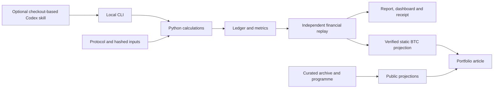

# Agenthon Quant Lab

Agenthon Quant Lab is a local Python toolkit for reproducible financial research. It grew out of Agenthon 2026 Track 1, where a program could finish and still get the trade accounting wrong. The toolkit records each assumption and checks portfolio results against an independent replay.

## Reproduce the four BTC studies

In an activated Python 3.12+ virtual environment, run from any writable directory. The package contains the admitted data and reference records, so the four commands run offline after installation. Choose fresh output folders on each run.

```sh
python -m pip install agenthon-quant-lab==0.5.0
quant-lab doctor
quant-lab btc-study --out runs/momentum
quant-lab btc-cost-break-even --out runs/costs
quant-lab btc-weekly-cadence --out runs/weekly
quant-lab btc-weekly-allocation --out runs/allocation
```

Open `runs/momentum/report.md` for the original result and `dashboard.html` in the same folder for the daily decisions. Open `README.md` in each follow-up folder for its findings and figure. [Installation and output guide](docs/user-guide.md) · [v0.5.0 qualification](docs/releases/v0.5.0.md) · [PyPI package](https://pypi.org/project/agenthon-quant-lab/0.5.0/)

## What survived the cost of trading?

All four analyses use the same previously examined 2020–2024 Bitstamp BTC/USD history. Each portfolio started with $10,000. The base case charges a 50 basis point fee and 10 basis points of adverse slippage per fill. Execution uses delayed minute-candle prices. Prospective observations total zero.

1. **Did daily momentum beat a simple allocation?** Buying BTC after a positive 20-session return produced $39,414 after costs. Passive BTC/cash, with its allocation set annually using earlier signals, finished at $70,715. The predictive-return and net-Sharpe intervals include zero. The fixed FFT filter reduced base net return from +294.14% to +41.83%. [Report](reports/btc-financial-v1/README.md) · [Protocol](experiments/btc-financial-v1/protocol.json)
2. **Where did costs reverse the comparison?** As fee and slippage increased together, daily momentum lost its net-Sharpe advantage over passive near 0.3071× base costs (15.35 bp fee plus 3.07 bp slippage). Terminal wealth crossed near 0.4781× (23.90 bp plus 4.78 bp). Those estimates describe this sample and cost ratio. [Report and figure](reports/btc-cost-break-even-v1/README.md) · [Protocol](experiments/btc-cost-break-even-v1/protocol.json)
3. **What changed when momentum could trade only on Mondays?** Using the completed Sunday close cut fills from 188 to 80. Weekly momentum finished at $48,686 after base costs, ahead of daily momentum and behind passive BTC/cash. Its maximum drawdown was slightly deeper (73.34% weekly, 71.82% daily). Both paired Sharpe intervals include zero. The two schedules held different positions on 292 closes. [Report and figure](reports/btc-weekly-cadence-v1/README.md) · [Protocol](experiments/btc-weekly-cadence-v1/protocol.json)
4. **What did restoring a 50% BTC target change?** At base costs, restoring the target on positive-signal Mondays cut maximum drawdown to 45.02%, compared with 64.45% for $5,000 in weekly momentum plus $5,000 held in cash. The reduction was 19.43 percentage points (paired conditional 95% interval +0.66 to +23.82). The target ended with $25,334.67 versus $29,342.96. Its BTC weight could drift between decisions. The interval uses resampled returns from the same historical paths. [Report and figure](reports/btc-weekly-allocation-v1/README.md) · [Protocol](experiments/btc-weekly-allocation-v1/protocol.json)

The [portfolio walkthrough](https://hnt119.github.io/projects/quant-finance-agents/) follows these comparisons from the financial question to the saved evidence. The [verification architecture](docs/financial-workbench.md) explains how each cash balance and BTC position can be checked independently.

## What works today

| Workflow | Outputs | Independent checks |
|---|---|---|
| European options | Call/put prices, five Greeks, volatility scenarios | Discounted bounds, parity, payoff quadrature, finite-difference convergence |
| Historical daily portfolios | Gross/net period tables, equity and drawdown CSV/SVG, frozen inputs | Strict session dates and mappings, continuous cash and holdings, independent benchmark paths |
| Single-asset SMA strategy | Gross/net returns, drawdown, exposure, turnover, costs, cash/trade/P&L ledgers, buy-and-hold | Hand-reconciled fixture, accounting identities, next-session timing, future-data invariance |
| Research and experiments | Search 12 papers and 18 evidence records by topic, date, mechanism or outcome | Canonical sources, source hashes, explicit unknowns and evidence categories |

## Research programme

The [six-study catalogue](research/programme.json) links five completed comparisons to four retrospective experiments. Daily momentum and the FFT gate share the original run. The cost, weekly cadence and weekly allocation studies each have their own protocol and receipt. Cross-asset validation remains proposed.

## Agenthon origins

Team 166’s agent inspected task inputs, generated financial programs and used a bounded repair attempt. In one diagnostic trial the repaired program produced all five required files, yet failed 13 of 35 accounting checks. The R29 evaluation passed 1,066 of 1,167 checks across the public roster and completed only 22 of 86 tasks successfully. Quant Lab independently verifies cash, holdings and equity and keeps failed outcomes in the denominator. [Three engineering cases and their evidence](docs/agenthon-architecture.md#three-decisions-from-the-archive) · [Attribution](docs/attribution.md)

## Architecture and verification



The project article displays saved research results. Its European option calculator uses a bounded browser approximation checked against 64 Python reference cases. The toolkit runs the financial research locally. [Portfolio walkthrough](https://hnt119.github.io/projects/quant-finance-agents/) · [Implemented modules and verification](docs/financial-workbench.md)

## Explore the toolkit

```sh
quant-lab example options --out runs/first-option
quant-lab example historical --out runs/btc-q2
quant-lab archive experiments self-debugging --status failed
quant-lab reproduce runs/first-option --out runs/repeated
```

Check the option prices, Greeks and assumptions in `runs/first-option/report.md`. The separate Q2 2025 daily example compares SMA, buy-and-hold and cash. Each output path must be fresh. Local data and run bundles can include private inputs. [Models and supported inputs](docs/user-guide.md) · [Historical portfolio guide](docs/historical-workflow.md) · [Optional skill setup](docs/plugin-guide.md)

For the evidence trail, read the [research index](research/README.md), [experiment register](experiments/README.md) and [negative results](docs/negative-results.md). For source development, start with the [developer guide](docs/development.md) and [contribution guide](CONTRIBUTING.md). Software carries the Team 166 MIT notice. The two bundled BTC data products and their derivatives have separate terms. [Data notices](DATA-NOTICES.md) · [License](LICENSE)
