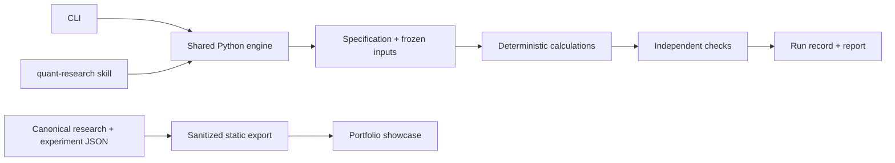

# Agenthon Quant Lab

**Financial calculations you can inspect, check and reproduce.**

A Python toolkit and Codex skill grown from Agenthon 2026 Track 1. Start with an
explicit specification; get deterministic calculations, independent checks,
frozen inputs and a readable report. A curated research and experiment archive
explains the mechanisms, failures and decisions behind the work.

**Review candidate v0.3.0rc1** adds daily historical portfolio comparisons. The example uses 91 Bitstamp BTC/USD observations from Q2 2025, adapted from minute bars under CC BY 4.0. Inspect the input, then compare the strategy, buy-and-hold and cash through training, validation and test periods. [Worked guide](docs/historical-workflow.md) · [Saved report](reports/historical-q2/report.md) · [Data attribution](examples/data/bitstamp/README.md)

## Start in a minute

Python **3.12+**, macOS or Linux. Windows interpreter paths are documented, but
fresh installation has been checked on macOS; Linux CI status is recorded in the release report.

```sh
git clone https://github.com/hnt119/agenthon-quant-lab.git
cd agenthon-quant-lab
python3 scripts/setup.py --install-skill
.venv/bin/python -m agenthon_quant doctor
.venv/bin/python -m agenthon_quant example options --out runs/first-option
```

Open `runs/first-option/report.md`. No API key, paid data or model endpoint is
needed. Setup installs free dependencies into `.venv`; calculations then work
offline. Omit `--install-skill` for CLI-only use. Existing skill destinations and
run directories are preserved. See the [setup guide](docs/user-guide.md).

## What works today

| Workflow | Outputs | Independent checks |
|---|---|---|
| European options | Call/put prices, five Greeks, volatility scenarios | Discounted bounds, parity, payoff quadrature, finite-difference convergence |
| Historical daily portfolios (v0.3 review) | Gross/net period tables, equity and drawdown CSV/SVG, frozen inputs | Strict session dates and mappings, continuous cash and holdings, independent benchmark paths |
| Single-asset SMA strategy | Gross/net returns, drawdown, exposure, turnover, costs, cash/trade/P&L ledgers, buy-and-hold | Hand-reconciled fixture, accounting identities, next-session timing, future-data invariance |
| Research and experiments | Search 12 papers and 17 evidence records by topic, date, mechanism or outcome | Canonical sources, source hashes, explicit unknowns and evidence categories |

For the [verified option example](reports/v0.1/options/report.md), spot and strike
are 100, maturity one year, volatility 20%, continuous rate 5% and dividend yield
2%: **call 9.2270055; put 6.3300806** per unit of underlying. Boundary quantities
and unavailable checks are reported explicitly.

The [synthetic strategy example](reports/v0.1/trading/report.md) returns **−9.0143%**
after 5 bps fees and 5 bps slippage, versus **−5.0435%** for buy-and-hold. The losing
result is preserved. Synthetic prices demonstrate mechanics, not a market edge.

## One engine, several ways in



The portfolio's browser calculator is a small, explicitly bounded static
implementation checked against **64 Python reference cases**. It does not host
Python, Docker, model inference or trading. The showcase is a separately reviewed
portfolio change; publication status is in the [release report](docs/releases/v0.2.0.md).

On the v0.3 review checkout, inspect the fixture and run the historical example from the repository root.

```sh
.venv/bin/python -m agenthon_quant inspect-data examples/historical.json
.venv/bin/python -m agenthon_quant example historical --out runs/btc-q2
```

Read `runs/btc-q2/report.md`. The CSV and SVG beside the report show the equity and drawdown paths. [Use your own prices or reproduce the example](docs/historical-workflow.md)

## Follow the evidence

[Start here](docs/index.md) → [Use the skill](docs/plugin-guide.md) →
[Financial models](docs/options-conventions.md) → [Research](research/README.md) →
[Experiments](experiments/README.md) → [Architecture](docs/agenthon-architecture.md) →
[Lessons learned](docs/negative-results.md)

```sh
.venv/bin/python -m agenthon_quant example trading --out runs/first-strategy
.venv/bin/python -m agenthon_quant archive papers verification
.venv/bin/python -m agenthon_quant archive experiments self-debugging --status failed
.venv/bin/python -m agenthon_quant reproduce runs/first-option --out runs/repeated
.venv/bin/python -m agenthon_quant bundle runs/first-option --out runs/first-option.zip
```

Bundles include input snapshots and local provenance and are **private by
default**. The website uses a separate allowlisted export. Historical live
experiments are inspectable summaries, not permission to rerun paid inference.

## Reproducibility and limits

Every run records source commit/fingerprint, input hashes, assumptions, package
versions, timing and passed/failed/unavailable checks. Failed runs retain their
evidence. Exact reproduction requires the matching source version; the original
`v0.1.0` tag and its reports remain immutable. See [methodology](docs/methodology.md)
and [verification](docs/releases/v0.2.0.md).

Options assume European exercise and constant continuous dividend yield. Trading
is long-only simulation with fractional shares; dividends, tax, liquidity,
market impact and cash interest are excluded. Source/price adjustments are user
declarations. Checks do not establish predictive accuracy or profitability.
Model assistance is mock-only. FFT, forecasting, training, broad strategy search
and live execution remain deferred; see the [roadmap](docs/next-milestone.md).

## Develop and contribute

```sh
.venv/bin/python -m unittest discover -s tests -v
.venv/bin/python scripts/export_site.py --check
.venv/bin/python scripts/verify_release.py --out runs/verification-NEW
```

Read the [developer guide](docs/development.md), [contribution guide](CONTRIBUTING.md)
and [attribution](docs/attribution.md). The MIT notice preserves Agenthon Team 166
contributor attribution. Organizer-only material, reference answers, raw private
captures and paper PDFs are excluded. No official ranking or organizer endorsement
is claimed.
