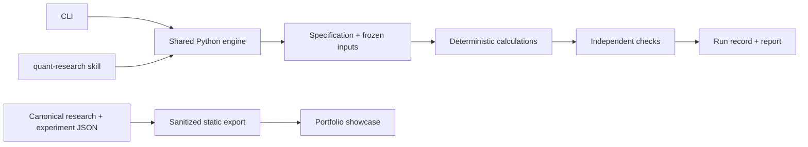

# Agenthon Quant Lab

Reproduce a financial study on your own computer, inspect its assumptions and see how the numbers were checked. The toolkit grew out of Agenthon 2026 Track 1, where independently checking a financial calculation mattered as much as producing an answer.

**Did buying BTC after a price rise pay for trading?** Across 2020–2024, a simulated $10,000 momentum account ended at **$39,414** after costs. A simpler BTC/cash account ended at **$70,715**. The momentum signal preceded somewhat higher daily returns, but the uncertainty interval includes zero. Adding the fixed FFT gate further reduced the after-cost return. The frozen research conclusion was **inconclusive**. [Read the illustrated example](examples/btc-study/README.md) · [See the checked results](reports/btc-financial-v1/README.md)

## Try it

The local v0.3.1 distribution candidate supports a checkout-free installation. For review, install its built wheel into a fresh environment with `python -m pip install /path/to/agenthon_quant_lab-0.3.1-py3-none-any.whl`, then run `quant-lab btc-study`. [Distribution guide](docs/releases/v0.3.1-pypi.md)

Install [v0.3.0](https://github.com/hnt119/agenthon-quant-lab/releases/tag/v0.3.0) from source with Git and Python 3.12. From the parent directory for your new checkout, run

```sh
git clone --branch v0.3.0 --single-branch https://github.com/hnt119/agenthon-quant-lab.git
cd agenthon-quant-lab
python3.12 scripts/setup.py --install-skill
.venv/bin/quant-lab btc-study
```

Or ask Codex: **“Use $quant-research to reproduce the frozen BTC momentum study, open the report, and explain how it compared with passive BTC/cash after costs.”**

Open the printed report or dashboard. The command uses the bundled data, creates a fresh output folder, and compares the results with the frozen evidence. It works offline after setup. Options pricing and local daily-data comparisons are also available. [Skill guide](docs/plugin-guide.md) · [Research scope and release review](docs/releases/v0.3.0-review.md)

## What works today

| Workflow | Outputs | Independent checks |
|---|---|---|
| European options | Call/put prices, five Greeks, volatility scenarios | Discounted bounds, parity, payoff quadrature, finite-difference convergence |
| Historical daily portfolios (v0.3) | Gross/net period tables, equity and drawdown CSV/SVG, frozen inputs | Strict session dates and mappings, continuous cash and holdings, independent benchmark paths |
| Single-asset SMA strategy | Gross/net returns, drawdown, exposure, turnover, costs, cash/trade/P&L ledgers, buy-and-hold | Hand-reconciled fixture, accounting identities, next-session timing, future-data invariance |
| Research and experiments | Search 12 papers and 18 evidence records by topic, date, mechanism or outcome | Canonical sources, source hashes, explicit unknowns and evidence categories |

For the [verified option example](reports/v0.1/options/report.md), spot and strike
are 100, maturity one year, volatility 20%, continuous rate 5% and dividend yield
2%: **call 9.2270055; put 6.3300806** per unit of underlying. Boundary quantities
and unavailable checks are reported explicitly.

The [synthetic strategy example](reports/v0.1/trading/report.md) returns **−9.0143%**
after 5 bps fees and 5 bps slippage, versus **−5.0435%** for buy-and-hold. The losing
result is preserved. Synthetic prices demonstrate mechanics, not a market edge.

## One engine, several ways in



The portfolio's browser calculator is a small, explicitly bounded static
implementation checked against **64 Python reference cases**. It does not host
Python, Docker, model inference or trading. The [live portfolio article](https://hnt119.github.io/projects/quant-finance-agents/) displays the verified BTC results.

On the v0.3 checkout, inspect the fixture and run the historical example from the repository root.

```sh
.venv/bin/python -m agenthon_quant inspect-data examples/historical.json
.venv/bin/python -m agenthon_quant example historical --out runs/btc-q2
```

In the saved example, the five-session moving average returned **+7.58%** after costs over the quarter and **−2.28%** in the held-out June period. Buy and hold returned **+28.14%** and **+2.42%** respectively. Read `runs/btc-q2/report.md` for the assumptions, period boundaries and costs. The CSV and SVG beside it show the daily paths. [Use your own prices or reproduce the example](docs/historical-workflow.md)

## Follow the evidence

[Start here](docs/index.md) → [Use the skill](docs/plugin-guide.md) →
[Financial models](docs/options-conventions.md) → [Research](research/README.md) →
[Experiments](experiments/README.md) → [Architecture](docs/agenthon-architecture.md) →
[Lessons learned](docs/negative-results.md)

```sh
.venv/bin/python -m agenthon_quant example trading --out runs/first-strategy
.venv/bin/python -m agenthon_quant archive papers verification
.venv/bin/python -m agenthon_quant archive experiments self-debugging --status failed
.venv/bin/python -m agenthon_quant reproduce runs/first-option --out runs/repeated
.venv/bin/python -m agenthon_quant bundle runs/first-option --out runs/first-option.zip
```

Bundles include input snapshots and local provenance and are **private by
default**. The website uses a separate allowlisted export. Historical live
experiments are inspectable summaries, not permission to rerun paid inference.

## Reproducibility and limits

Every run records source commit/fingerprint, input hashes, assumptions, package
versions, timing and passed/failed/unavailable checks. Failed runs retain their
evidence. Exact reproduction requires the matching source version; the original
`v0.1.0` tag and its reports remain immutable. See [methodology](docs/methodology.md)
and [verification](docs/releases/v0.2.0.md).

Options assume European exercise and constant continuous dividend yield. Trading
is long-only simulation with fractional shares; dividends, tax, liquidity,
market impact and cash interest are excluded. Source/price adjustments are user
declarations. Checks do not establish predictive accuracy or profitability.
The BTC study uses a trailing FFT entropy diagnostic. The toolkit runs deterministic calculations locally. See the [implemented architecture and research boundaries](docs/financial-workbench.md).

## Develop and contribute

```sh
.venv/bin/python -m unittest discover -s tests -v
.venv/bin/python scripts/export_site.py --check
.venv/bin/python scripts/verify_release.py --out runs/verification-NEW
```

Read the [developer guide](docs/development.md), [contribution guide](CONTRIBUTING.md)
and [attribution](docs/attribution.md). The MIT notice preserves Agenthon Team 166
contributor attribution. Organizer-only material, reference answers, raw private
captures and paper PDFs are excluded. No official ranking or organizer endorsement
is claimed.
