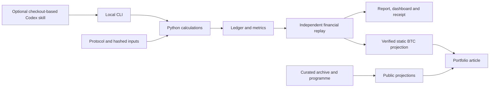

# Agenthon Quant Lab

Agenthon Quant Lab is a local Python toolkit for reproducible financial research. It grew out of Agenthon 2026 Track 1, where a program could finish and still get the trade accounting wrong. The toolkit records each assumption and checks portfolio results against an independent replay.

## Reproduce the Bitcoin study

Activate a Python 3.12+ virtual environment and run these commands from a writable directory. The published package includes the data and reference outputs. The study runs offline after installation.

```sh
python -m pip install agenthon-quant-lab==0.3.1
quant-lab doctor
quant-lab btc-study
```

Open the printed `report.md` for the finding and `dashboard.html` for the daily decisions. The accompanying `reproduction.json` records which outputs matched and how they were compared. Each run writes a fresh folder. [PyPI package](https://pypi.org/project/agenthon-quant-lab/0.3.1/) · [Installation and run guide](docs/user-guide.md) · [Tested platforms](docs/releases/v0.3.1-pypi.md)

## Did buying Bitcoin after a rise pay for the extra trading?

In five retrospective Bitstamp BTC/USD evaluation years (2020–2024), the momentum rule held BTC when its completed close exceeded the close 20 sessions earlier. It turned $10,000 into **$39,414** with 188 fills. The passive account used earlier signals to set its BTC share once each year, made five fills and ended at **$70,715**. Both accounts paid the same illustrative 0.50% fee and 0.10% adverse slippage on each fill. Removing those frictions reversed their ranking. Buy-and-hold still finished above momentum under zero friction. [Financial report and cost scenarios](reports/btc-financial-v1/README.md#costs-delay-and-the-negative-fft-result)

The estimated predictive return spread and the base-case momentum-minus-passive Sharpe difference both had 95% intervals containing zero. Adding the fixed FFT entropy filter reduced base net return from +294.14% to +41.83%. Evidence of a repeatable momentum advantage is **inconclusive**. The historical fills use delayed minute-candle prices. Prospective performance is unmeasured. [Frozen protocol](experiments/btc-financial-v1/protocol.json) · [Saved example](examples/btc-study/README.md) · [Independent verification](reports/btc-financial-v1/verification.json)

## What works today

| Workflow | Outputs | Independent checks |
|---|---|---|
| European options | Call/put prices, five Greeks, volatility scenarios | Discounted bounds, parity, payoff quadrature, finite-difference convergence |
| Historical daily portfolios | Gross/net period tables, equity and drawdown CSV/SVG, frozen inputs | Strict session dates and mappings, continuous cash and holdings, independent benchmark paths |
| Single-asset SMA strategy | Gross/net returns, drawdown, exposure, turnover, costs, cash/trade/P&L ledgers, buy-and-hold | Hand-reconciled fixture, accounting identities, next-session timing, future-data invariance |
| Research and experiments | Search 12 papers and 18 evidence records by topic, date, mechanism or outcome | Canonical sources, source hashes, explicit unknowns and evidence categories |

## Research programme

The [six-study catalogue](research/programme.json) records the question, status, evidence and next action for each study. Plain momentum and its FFT gate share the completed BTC experiment. The separate [descriptive cost study](reports/btc-cost-break-even-v1/README.md) replays the same history along one fee/slippage ratio. Momentum's net Sharpe fell below passive near 0.3071× base costs, before their terminal wealth crossed near 0.4781×. Buy-and-hold ended with more wealth at all 41 sampled settings. These are historical comparisons on a declared grid. A [weekly decision schedule](reports/btc-weekly-cadence-v1/README.md) cut fills from 188 to 80. At base costs it gained 0.081 Sharpe over daily momentum but trailed passive BTC/cash by 0.261. Both paired intervals include zero. [Reproduce the weekly study](experiments/btc-weekly-cadence-v1/README.md). Dynamic allocation and cross-asset validation remain proposed. [Reproduce the development study](experiments/btc-cost-break-even-v1/README.md)

## Agenthon origins

Team 166’s agent inspected task inputs, generated financial programs and used a bounded repair attempt. In one diagnostic trial the repaired program produced all five required files, yet failed 13 of 35 accounting checks. The R29 evaluation passed 1,066 of 1,167 checks across the public roster and completed only 22 of 86 tasks successfully. Quant Lab independently verifies cash, holdings and equity and keeps failed outcomes in the denominator. [Three engineering cases and their evidence](docs/agenthon-architecture.md#three-decisions-from-the-archive) · [Attribution](docs/attribution.md)

## Architecture and verification



The project article displays saved research results. Its European option calculator uses a bounded browser approximation checked against 64 Python reference cases. The toolkit runs the financial research locally. [Portfolio walkthrough](https://hnt119.github.io/projects/quant-finance-agents/) · [Implemented modules and verification](docs/financial-workbench.md)

## Explore the toolkit

```sh
quant-lab example options --out runs/first-option
quant-lab example historical --out runs/btc-q2
quant-lab archive experiments self-debugging --status failed
quant-lab reproduce runs/first-option --out runs/repeated
```

Check the option prices, Greeks and assumptions in `runs/first-option/report.md`. The separate Q2 2025 daily example compares SMA, buy-and-hold and cash. Each output path must be fresh. Local data and run bundles can include private inputs. [Models and supported inputs](docs/user-guide.md) · [Historical portfolio guide](docs/historical-workflow.md) · [Optional skill setup](docs/plugin-guide.md)

For the evidence trail, read the [research index](research/README.md), [experiment register](experiments/README.md) and [negative results](docs/negative-results.md). For source development, start with the [developer guide](docs/development.md) and [contribution guide](CONTRIBUTING.md). Software carries the Team 166 MIT notice. The two bundled BTC data products and their derivatives have separate terms. [Data notices](DATA-NOTICES.md) · [License](LICENSE)
