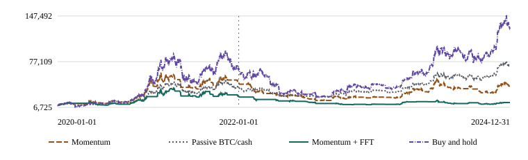

# Did buying BTC after a rise earn enough to cover trading costs?

On Bitstamp from 2020 through 2024, did buying BTC when its last daily close was higher than 20 sessions earlier pay for the trading it required? We used the preceding 2017–2019 history for the initial fit.

Starting with $10,000, momentum finished at $39,414 after costs. Passive BTC/cash finished at $70,715. The passive account set its BTC share once each year from earlier signals and held the rest in cash. Each fill paid a 0.50% fee and assumed a 0.10% worse price.

Momentum made 188 trades against the passive account’s 5. Its deepest fall from a previous closing high (drawdown) was 71.82%, versus 53.52%. Its Sharpe ratio, which measures average return relative to variability, was 0.825 versus 1.166.

The price signal and the investment answer different questions. The next day’s BTC return averaged 0.207 percentage points more after a positive signal. The 95% interval spans -0.096 to +0.495 points. The interval for the net Sharpe difference spans -0.980 to +0.265. The passive account did better here. Both intervals include zero, so the study’s decision is inconclusive. Future performance is unmeasured.

[View equity curves](../../reports/btc-financial-v1/equity.svg) · [Read the financial report](../../reports/btc-financial-v1/README.md) · [Download the offline dashboard](dashboard.html) · [Reproduce this study](../../docs/plugin-guide.md)

The secondary rule required positive momentum and a concentrated pattern in the last 64 returns. It finished at $14,183. The complete report covers cash, buy and hold, annual periods and cost sensitivities.

[Frozen specification](../../experiments/btc-financial-v1/protocol.json) · [Numerical checks](../../reports/btc-financial-v1/verification.json) · [Earlier six-month pilot](../../research/btc-pilot-audit/README.md)

Adapted from Zielak (mczielinski), *Bitcoin Historical Data*, Kaggle v706, normalized by ff137. The UTC portfolio tables and plots use [CC BY-SA 4.0](https://creativecommons.org/licenses/by-sa/4.0/).
