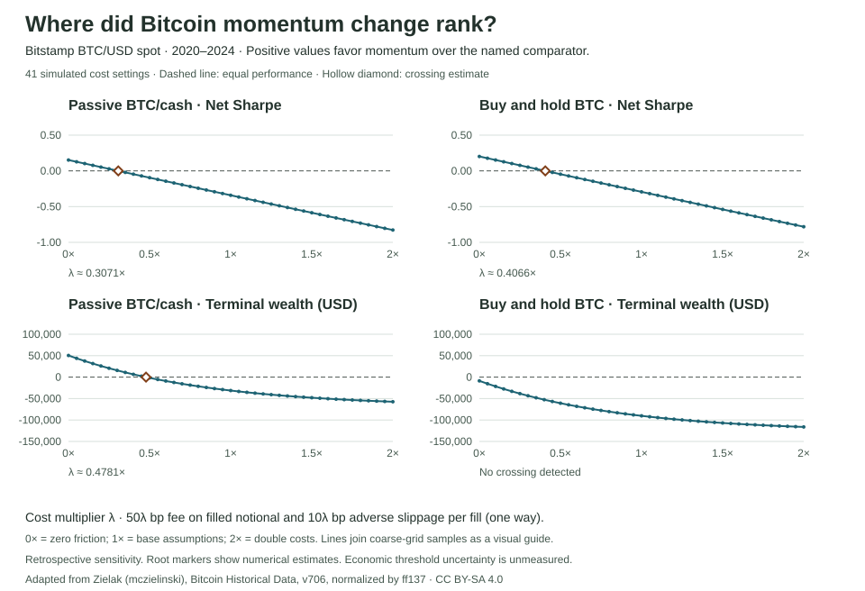

# Where did trading costs reverse the Bitcoin momentum comparison?

Five retrospective calendar years of Bitstamp spot BTC/USD, January 2020 through December 2024. All accounts began with $10,000. A positive difference favors momentum.

Momentum moved from ahead to behind passive BTC/cash on net Sharpe near **0.3071×** base costs (15.35 bp fee and 3.07 bp slippage per fill).

Momentum moved from ahead to behind passive BTC/cash on terminal wealth near **0.4781×** base costs (23.90 bp fee and 4.78 bp slippage per fill).

Sharpe measures average daily net return relative to daily variability. Terminal wealth measures the dollars remaining at the last close. A change in rank can occur at different costs for these two criteria.



## What was held fixed

The long-only rule enters BTC after a positive 20-session change in completed closes and otherwise holds cash. The passive account sets its BTC share once per year from earlier signals and lets it drift. The buy-and-hold account pays its entry costs. The grid also retains zero-interest cash and the original 64-return FFT-gated rule. The original prices, training-period entropy threshold, allocation weights and decision times are fixed for every simulation.

Let λ scale the one-way fee of 50 basis points on filled value and the adverse slippage of 10 basis points on the quote. Each simulated trade uses the first trade-bearing minute open at or after 00:05 UTC following the completed-close decision. Each multiplier uses a fresh continuous replay of every portfolio with its own available cash, quantities and costs. The final mark uses the last daily close without a liquidation trade.

## Pooled outcomes at the original cost settings

| λ | Fee / slippage per fill (bp) | Momentum USD | Passive USD | Hold BTC USD | Δ Sharpe vs passive | Δ Sharpe vs hold |
|---:|---:|---:|---:|---:|---:|---:|
| 0× | 0 / 0 | 121,770.72 | 71,280.72 | 130,483.81 | +0.152 | +0.202 |
| 1× | 50 / 10 | 39,414.43 | 70,715.27 | 129,704.93 | -0.341 | -0.293 |
| 2× | 100 / 20 | 12,756.96 | 70,153.50 | 128,934.02 | -0.827 | -0.782 |

At base costs momentum made 188 fills with 187.44× turnover and paid $33,621.18 in fees plus slippage. Passive BTC/cash made 5 fills with 1.33× turnover and paid $176.71. Repeated trading changed both subsequent position sizes and compounding. The accumulated charges and the final difference in wealth measure different effects.

## Where the differences changed sign

| Comparator | Momentum minus comparator | Search outcome | Final λ bounds | Estimate λ |
|---|---|---|---:|---:|
| Passive BTC/cash | Net Sharpe | bracketed | 0.3070313 to 0.3071289 | 0.3070801 |
| Passive BTC/cash | Terminal wealth (USD) | bracketed | 0.4780273 to 0.4781250 | 0.4780762 |
| Buy and hold BTC | Net Sharpe | bracketed | 0.4065430 to 0.4066406 | 0.4065918 |
| Buy and hold BTC | Terminal wealth (USD) | no crossing detected | — | — |

The search inspected all 41 simulated grid settings, from 0× to 2× at 0.05× increments. Opposite, defined signs at adjacent points triggered bisection with target bracket width 0.0001×, at most 12 midpoints per bracket and 256 additional settings overall. Sampled differences within 1e-10 Sharpe units or $1e-06 of zero count as equality within tolerance. For a bracketed crossing the estimate is the midpoint of its final bounds. The crossing record retains the two checked endpoint values, undefined samples and nearly flat intervals. Equal signs at adjacent samples can hide other crossings.

## Calendar-year behavior under base costs

| Year | Portfolio | Net return | Net Sharpe | Turnover | Fills | Fees + slippage, USD |
|---|---|---:|---:|---:|---:|---:|
| 2020 | Momentum | +262.65% | 2.751 | 28.91× | 29 | 2,563.21 |
| 2020 | Passive BTC/cash | +168.84% | 2.365 | 0.55× | 1 | 33.29 |
| 2020 | Buy and hold | +302.71% | 2.247 | 0.99× | 1 | 59.69 |
| 2021 | Momentum | +20.97% | 0.615 | 39.88× | 40 | 10,556.72 |
| 2021 | Passive BTC/cash | +35.02% | 0.817 | 0.24× | 1 | 39.33 |
| 2021 | Buy and hold | +59.40% | 0.978 | 0.00× | 0 | 0.00 |
| 2022 | Momentum | -60.49% | -2.486 | 50.85× | 51 | 7,915.27 |
| 2022 | Passive BTC/cash | -37.56% | -1.442 | 0.11× | 1 | 24.97 |
| 2022 | Buy and hold | -64.24% | -1.283 | 0.00× | 0 | 0.00 |
| 2023 | Momentum | +94.14% | 2.068 | 25.92× | 26 | 3,588.57 |
| 2023 | Passive BTC/cash | +85.68% | 2.246 | 0.22× | 1 | 29.49 |
| 2023 | Buy and hold | +155.68% | 2.350 | 0.00× | 0 | 0.00 |
| 2024 | Momentum | +17.14% | 0.584 | 41.87× | 42 | 8,997.41 |
| 2024 | Passive BTC/cash | +68.03% | 1.643 | 0.20× | 1 | 49.62 |
| 2024 | Buy and hold | +120.98% | 1.744 | 0.00× | 0 | 0.00 |

Each year's return starts at the preceding December close (initial capital in 2020). Positions carry across each year boundary. Sharpe uses daily close-to-close returns, sample standard deviation, a zero cash rate and √365 annualization. Turnover sums one-way quoted trade value divided by pretrade equity. All five accounts' annual and pooled results at every coarse-grid cost are in the [grid](grid.json).

## What this can establish

These are descriptive thresholds conditional on one fee/slippage ratio and previously examined BTC history. A bracket’s width describes numerical precision. Economic uncertainty about the threshold remains unmeasured. The original predictive and base-case Sharpe intervals both included zero. They do not give a confidence interval for either crossing. Candle-price proxies leave actual spreads, latency, order size and available account fees uncertain. There are no prospective outcomes.

A separate turnover study could predeclare a slower decision cadence or different entry and exit rules, charge the same costs and compare both turnover and market exposure. The current results evaluate the original daily rule alone.

## Reproduce and inspect

From a writable directory with the study development wheel installed, run

```sh
quant-lab btc-cost-break-even --out btc-cost-review
```

Use a fresh destination. The published v0.3.1 package runs the original study with `quant-lab btc-study`. The cost-crossing command is available in the 0.4.0.dev1 review build.

[Protocol](protocol.json) · [Full grid](grid.json) · [Crossing records](crossings.json) · [Independent checks](verification.json) · [Run and source identity](run.json) · [Public exhibit](public.json) · [Original BTC report](https://github.com/hnt119/agenthon-quant-lab/blob/v0.3.1/reports/btc-financial-v1/README.md)

Zielak (mczielinski), Bitcoin Historical Data, Kaggle v706, normalized by ff137. Adapted to UTC sessions, simulated spot portfolios and a fee/slippage sensitivity analysis. The derived report, figure and results use [CC BY-SA 4.0](https://creativecommons.org/licenses/by-sa/4.0/). [Original dataset](https://www.kaggle.com/datasets/mczielinski/bitcoin-historical-data) · [Publisher terms](https://github.com/ff137/bitstamp-btcusd-minute-data/blob/d7156d68d85714e188a1e152818281e97c89fbe5/DATA_LICENSE)
