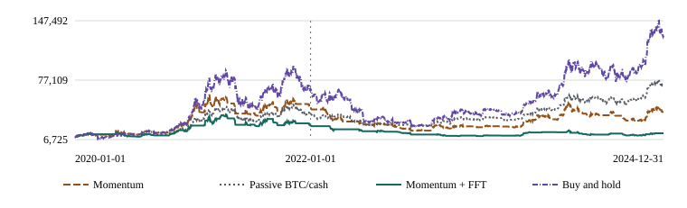

# Does short-term BTC momentum pay for trading?

**The five-year retrospective evidence is inconclusive.** A positive 20-session signal preceded a **20.7 basis point** higher average next-interval return. Its paired 95% interval ran from **−9.6 to +49.5 bp**. A $10,000 momentum account grew to **$39,414** after costs. A passive BTC/cash allocation set using past signals grew to **$70,715** with fewer trades and a smaller drawdown. Momentum’s net Sharpe difference versus that comparator was **−0.341**, with a 95% interval of **−0.980 to +0.265**. [Verified dashboard](dashboard.html) · [All 120 portfolio summaries](tables.csv) · [Offline reproduction](../../experiments/btc-financial-v1/README.md)

## What was frozen

The primary hypothesis was that the sign of completed-close momentum predicts subsequent tradable returns and improves cost-adjusted performance versus a passive allocation with substantial cash exposure. We selected eight complete, pre-2025 UTC calendar years on data availability and quality. We froze definitions, the admitted file, the decision rule and sensitivities before computing new strategy performance. This design was informed by the previously examined 2025–2026 pilot. All results below are historical. Prospective performance is unmeasured. [Protocol at freeze](../../experiments/btc-financial-v1/protocol.json) · [Run identity](run.json)

- **Development, 2017–2019.** The signal uses 21 closes and is positive when the last close exceeds its value 20 sessions earlier. The secondary FFT gate requires 64 completed log returns. It admits positive momentum when normalized spectral entropy is at or below the median of the initial training observations. The 1,031 eligible windows gave **0.899325**. This threshold was fixed for every evaluation year.
- **Five annual folds, 2020–2024.** Before each year, the passive comparator uses the fraction of eligible prior signals that were positive. Its BTC weights were **55.63%, 59.26%, 58.47%, 55.18% and 56.39%**. The book rebalances to this post-cost weight at the first delayed quote of the new year, then carries its units and cash. The allocation can drift substantially. No evaluation-period exposure is used to set it. [Fit membership and annual counts](fit.json)
- **Two endpoints.** Prediction compares the conditional mean BTC price return from one delayed quote to the next. Both label endpoints must lie in the same fold. Dropping the last entry date of each year leaves 1,822 labels across 1,827 evaluation sessions. Investment compares the Sharpe ratios of the continuous momentum and passive books, using daily net returns including cash days, zero interest and sample volatility annualized by √365. The books retain all evaluation sessions.
- **Execution.** At the midnight UTC cutoff the prior close is complete. The first positive-volume candle open at or after 00:05 proxies a fill. Each arm starts with $10,000 cash, buys fractional spot units, receives zero cash interest and carries positions across years. Each fill incurs 50 bp of filled notional in fees and 10 bp of adverse slippage. These are illustrative one-way costs. Terminal units are marked at the final close. Taxes, borrowing and forced final liquidation are excluded.

## Prediction and investment gave different answers

The mean next-interval return was **+29.0 bp** after 1,052 positive signals and **+8.3 bp** after 770 non-positive signals. This price comparison describes conditional returns before investor-specific friction. Its sign varied across years. The portfolio comparison includes what it cost to act each time the signal changed.

| Base portfolio | Net total | Annualized | Sharpe | Volatility | Max drawdown | Mean BTC weight | Turnover | Fills | Fees / slippage, USD |
|---|---:|---:|---:|---:|---:|---:|---:|---:|---:|
| Momentum | +294.14% | +31.52% | 0.825 | 45.86% | 71.82% | 57.69% | 187.44× | 188 | 28,018 / 5,604 |
| Passive BTC/cash | +607.15% | +47.81% | 1.166 | 40.66% | 53.52% | 62.52% | 1.33× | 5 | 147 / 29 |
| Momentum + FFT | +41.83% | +7.23% | 0.373 | 35.43% | 70.28% | 34.26% | 149.55× | 150 | 13,519 / 2,704 |
| Buy and hold | +1,197.05% | +66.86% | 1.118 | 65.25% | 76.66% | 100% | 0.99× | 1 | 50 / 10 |
| Cash | 0% | 0% | Undefined | 0% | 0% | 0% | 0× | 0 | 0 / 0 |

Turnover sums one-way quoted notional divided by equity immediately before each trade. Dollar costs accumulate on the capital actually invested over time. The gap between gross and net ending wealth includes foregone compounding as well as individual charges. Annualized return is geometric over the observed session count. Drawdowns use closing marks. The passive book’s 62.52% average exposure is a measured outcome of drift.

| Fold | Momentum net | Passive net | Buy and hold | FFT net | Net Sharpe difference¹ | Predictive spread, bp |
|---|---:|---:|---:|---:|---:|---:|
| 2020 | +262.65% | +168.84% | +302.71% | +133.15% | +0.386 | +51.9 |
| 2021 | +20.97% | +35.02% | +59.40% | +0.24% | −0.202 | +20.1 |
| 2022 | −60.49% | −37.56% | −64.24% | −45.71% | −1.044 | −28.2 |
| 2023 | +94.14% | +85.68% | +155.68% | +22.40% | −0.177 | +26.4 |
| 2024 | +17.14% | +68.03% | +120.98% | −8.68% | −1.059 | −7.9 |

¹ Plain momentum minus passive BTC/cash. Cash earned zero in every fold. The full-period capital growth partly reflects owning BTC during a five-year increase. A passive mix earned more net return with less realized risk. Holding cash reduced the FFT book’s exposure, but even its 70.28% drawdown exceeded the passive book’s 53.52%.

## Costs, delay and the negative FFT result

| Scenario | Momentum total | Passive total | FFT total | Buy and hold total | Momentum minus passive Sharpe |
|---|---:|---:|---:|---:|---:|
| Zero fee and slippage, 5 min | +1,117.71% | +612.81% | +248.84% | +1,204.84% | +0.152 |
| Base, 5 min | +294.14% | +607.15% | +41.83% | +1,197.05% | −0.341 |
| Double costs, 5 min | +27.57% | +601.54% | −42.34% | +1,189.34% | −0.827 |
| Base costs, 30 min | +311.20% | +606.76% | +43.21% | +1,196.72% | −0.322 |

Moving the proxy to 00:30 produced a predictive spread of **+22.0 bp**. Delaying execution did little to change the investment comparison. Moving from zero friction to base costs reversed the risk-adjusted ranking. Momentum beat cash under base costs and under double costs, while incurring considerably more turnover than passive BTC/cash. Cash stayed flat in all four scenarios. The dashboard and CSV include each arm, fold and stress. [Executable labels](predictions.json) · [Full metrics and intervals](metrics.json)

The secondary gate cut mean exposure from 57.69% to 34.26% and turnover from 187.44× to 149.55×. It also reduced base total return by **252.32 percentage points** using unrounded values, with only a 1.54-point reduction in maximum drawdown. The earlier, separate April–September 2026 evaluation had already found **+9.72% plain versus +1.36% gated**, a **−8.37-point** difference on its unrounded returns. That pilot’s exposure-matching exercise was post hoc. This study uses an executable, training-calibrated comparator. The periods, thresholds, and execution proxies differ, so the two estimates are kept separate. [Earlier independent audit](../../research/btc-pilot-audit/README.md)

## Uncertainty and decision

We resampled 20-session contiguous circular blocks within each year, pairing both portfolios on the same dates and pairing each predictive label with its state. Four thousand replicates, seed 20261121, give percentile intervals conditional on these five historical folds and the fitted rules. A fixed block length approximates local dependence. Resampling cannot create additional market cycles, account for all regime changes or recover feed arrival times.

The candidate rule required positive lower bounds on both endpoints, positive net momentum return, a positive Sharpe advantage in at least three folds and a positive advantage under both stresses. Only 2020 had a positive base Sharpe advantage. Both interval estimates straddle zero, and the predictive point estimate is positive. The criteria for either candidate status or an unsupported result were unmet. **Inconclusive** is the frozen decision. The workbench supports manually recording fresh signals under this configuration. Future paper outcomes would require genuinely later, timestamped observations.

## Data quality, implementation and limits

The admitted extract contains 2,922 daily sessions and 4,207,680 minute labels. The extractor found zero missing, duplicate or invalid labels in the selected grid. It excluded 143,463 zero-volume minutes from execution proxies. The price proxy landed later than 00:05 on 75 dates and later than 00:30 on 83 dates. The latest proxy was 00:45. The anomaly screen found zero within-candle high/low ratios above 1.2 or consecutive trade-bearing candle opening gaps above 20%. Those screens do not establish continuous exchange uptime. The file is a later published vintage. Historical revisions, bid/ask, trade queue, capacity and intra-minute latency are unknown. Single-venue appreciation and one set of cost assumptions constrain economic interpretation. [Qualified source](../../experiments/btc-financial-v1/source.json)

The independent verifier rebuilt training membership and features using a direct Fourier transform, checked annual passive weights, compared every cash and quantity movement against the quote and target, and reconciled compounding and risk metrics. It checked 20 portfolios, 36,540 portfolio-day records and 120 portfolio-period summaries. Tests cover future-data invariance, incorrect fill timing, altered balances and boundary-date exclusion. These checks establish accounting and timing under the assumptions. Predictive evidence comes from the retrospective comparison and its uncertainty. [Verification receipt](verification.json) · [Architecture, Agenthon methods and replication scope](../../docs/financial-workbench.md)

Historical data and derived financial outputs adapt Zielak’s *Bitcoin Historical Data* (Kaggle v706), normalized by ff137. This report, data-derived figures and tables are available under CC BY-SA 4.0. Changes include UTC aggregation, delayed trade-price selection and simulated portfolio accounting. [Source, attribution and license](../../experiments/btc-financial-v1/README.md#attribution-and-redistribution) · [License](https://creativecommons.org/licenses/by-sa/4.0/)
