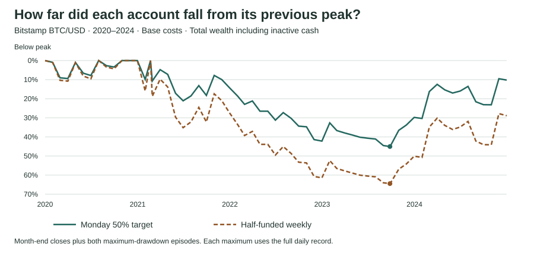

# Did a weekly 50% BTC target reduce the worst decline beyond starting smaller?

Both accounts began with $10,000. One traded back to 50% BTC on positive-momentum Mondays. The other put half its initial capital in the original weekly strategy and left the other half in cash. Both followed the same Sunday-close signal from 2020-01-01 through 2024-12-31.

The Monday target’s maximum drawdown was **19.43 percentage points smaller**. Subtracting target drawdown from half-funded drawdown gives **+19.43 points** (paired 95% interval **+0.66 to +23.82**). The interval favors the target on drawdown within this retrospective comparison.

The target ended at **$25,334.67** and the half-funded account at **$29,342.96**. Their average daily closing BTC weights were 29.65% and 44.09%, respectively. The target finished $4,008.30 behind the sizing control. Fees and adverse slippage totaled $4,897.88 and $8,347.87.



| Base-cost account | Peak close | Trough close | Drawdown | BTC at peak | BTC at trough |
|---|---:|---:|---:|---:|---:|
| Monday 50% target | 2021-02-21 | 2023-09-26 | 45.02% | 54.12% | 49.99% |
| Half-funded weekly | 2021-02-21 | 2023-09-26 | 64.45% | 87.88% | 65.91% |

The chart samples closing marks. Maximum drawdown uses every daily close and includes the inactive cash. Each account can reach its peak and trough on different days.

## Where the exposure changed

After a strictly positive 20-session return at the completed Sunday UTC close, the target traded at the first trade-bearing Monday minute open at or after 00:05 UTC. It aimed to hold half of post-cost wealth in BTC, valued at the unadjusted quote. A zero or negative signal liquidated BTC. Between decisions units and cash stayed fixed, so BTC weight could rise above or fall below 50%.

There were **114 Mondays with consecutive positive signals**. Restoring the target generated 114 fills on those days (77 sales and 37 purchases), 1.70× one-way turnover, $171.79 in fees and $34.38 in adverse slippage. The half-funded weekly sleeve held its units on those Mondays. Selling after a rise reduced exposure to subsequent price moves, while buying after a fall increased it. Costs and the sequence of those moves both affected wealth.

| First purchase | UTC date | Monday target | Half-funded BTC weight | Target minus control (points) |
|---|---:|---:|---:|---:|
| Zero | 2020-01-06 | 50.0000% | 50.0000% | +0.0000 |
| Base | 2020-01-06 | 50.0000% | 49.8503% | +0.1497 |
| Double | 2020-01-06 | 50.0000% | 49.7013% | +0.2987 |

At positive costs the half-funded account paid for its first fill from the active sleeve. Its BTC at the unadjusted quote was then worth slightly less than its untouched $5,000 reserve. The target account allowed for costs when sizing the purchase. At every close the sizing control was worth $5,000 plus half the full-size weekly account. Its active share of total wealth changed over time.

## Base-cost account comparison

| Account | Ending wealth | Return | Sharpe | Max drawdown | Avg BTC | Fills | Turnover | Fees | Slippage |
|---|---:|---:|---:|---:|---:|---:|---:|---:|---:|
| Monday 50% target | $25,335 | +153.35% | 0.906 | 45.02% | 29.65% | 194 | 40.93× | $4,081.55 | $816.33 |
| Half-funded weekly | $29,343 | +193.43% | 0.776 | 64.45% | 44.09% | 80 | 60.13× | $6,956.54 | $1,391.33 |
| Full-size weekly | $48,686 | +386.86% | 0.906 | 73.34% | 59.00% | 80 | 79.76× | $13,913.07 | $2,782.67 |
| Daily momentum | $39,414 | +294.14% | 0.825 | 71.82% | 57.69% | 188 | 187.44× | $28,017.60 | $5,603.58 |
| Annual passive BTC/cash | $70,715 | +607.15% | 1.166 | 53.52% | 62.52% | 5 | 1.33× | $147.25 | $29.46 |

The passive account set its BTC weight once each year using earlier training observations. All accounts paid the scenario’s costs on actual fills and earned zero cash interest. Sharpe uses each account’s own daily total-wealth returns, their sample standard deviation and 365-day annualization. Turnover sums quoted traded values divided by pretrade wealth at each fill.

## Cost sensitivity and calendar years

| Fee + slippage per fill | Target drawdown | Half-funded drawdown | Difference (points) | Target ending wealth | Half-funded ending wealth |
|---|---:|---:|---:|---:|---:|
| Zero (0 + 0 bp) | 37.17% | 56.77% | +19.60 | $32,397.98 | $44,340.17 |
| Base (50 + 10 bp) | 45.02% | 64.45% | +19.43 | $25,334.67 | $29,342.96 |
| Double (100 + 20 bp) | 52.68% | 69.84% | +17.16 | $19,810.94 | $20,062.67 |

| Year at base costs | Target return | Half-funded return | Target drawdown | Half-funded drawdown |
|---|---:|---:|---:|---:|
| 2020 | +115.51% | +169.24% | 10.74% | 12.17% |
| 2021 | +12.17% | +11.15% | 24.98% | 40.33% |
| 2022 | -32.51% | -46.84% | 34.14% | 48.88% |
| 2023 | +21.47% | +29.40% | 19.45% | 26.79% |
| 2024 | +27.84% | +42.52% | 18.53% | 29.06% |

For the pooled result the peak starts at initial capital. For each annual drawdown the peak starts at the preceding year-end closing wealth, or initial capital in the first year. Cash and holdings continue through every year boundary. The [full metrics](metrics.json) give pooled and annual results for all five accounts under all three cost settings.

## Uncertainty and limits

The paired interval uses 4,000 draws of circular 20-session blocks within calendar years. Each draw takes the same dates for the full-size weekly and target returns, compounds both paths continuously across years and reconstructs the half-funded account with its fixed cash reserve at every simulated close. The interval describes variation conditional on these observed portfolio returns. It does not simulate fills on new price histories. A handful of peaks and troughs can determine a drawdown estimate.

These studies reuse previously examined Bitstamp BTC/USD history. Minute-candle opening prices stand in for fills. Actual spreads, fees, depth and latency can differ. There are zero prospective observations.

## Reproduce and inspect

Use the development build containing this study in a Python 3.12+ environment and choose a fresh output directory. Public v0.4.0 provides the three earlier studies.

```sh
quant-lab btc-weekly-allocation --out runs/allocation
```

[Frozen protocol](protocol.json) · [Daily accounting ledger](ledger.jsonl.gz) · [Verification](verification.json) · [Run receipt](run.json) · [Public exhibit](public.json) · [Original weekly comparison](https://github.com/hnt119/agenthon-quant-lab/blob/v0.4.0/reports/btc-weekly-cadence-v1/README.md)

Zielak (mczielinski), Bitcoin Historical Data, Kaggle v706, normalized by ff137. Adapted to UTC daily sessions, simulated spot accounts and weekly allocation comparisons. The derived report, figure and numerical exhibits use [CC BY-SA 4.0](https://creativecommons.org/licenses/by-sa/4.0/). [Original dataset](https://www.kaggle.com/datasets/mczielinski/bitcoin-historical-data) · [Publisher terms](https://github.com/ff137/bitstamp-btcusd-minute-data/blob/d7156d68d85714e188a1e152818281e97c89fbe5/DATA_LICENSE)
