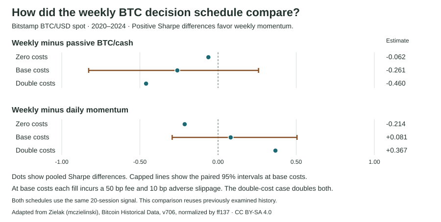

# Did weekly decisions improve BTC momentum after costs?

Bitstamp BTC/USD spot, 2020-01-01 through 2024-12-31. Both momentum accounts used the same change over 20 daily closes. One could change position every day. The other could act only once each Monday, using the completed Sunday close.

Weekly minus passive BTC/cash: **-0.261** (paired 95% interval **-0.828 to +0.259**). The interval includes zero and leaves the comparison inconclusive.

Weekly minus daily momentum: **+0.081** (paired 95% interval **-0.293 to +0.505**). The interval includes zero and leaves the comparison inconclusive.



## Turnover, timing and exposure

The weekly account made **80 fills** over 261 scheduled opportunities. Daily momentum made **188 fills**. One-way turnover was 79.76× for weekly and 187.44× for daily. Across the five years, fees and adverse slippage totaled $16,695.74 for weekly and $33,621.18 for daily.

Weekly momentum held an average closing BTC weight of 59.00%, compared with 57.69% for daily. Only weekly held BTC on 158 closes. Only daily held BTC on 134 closes. Both held BTC on 920 closes and both held cash on 615. The first weekly opportunity was 2020-01-06. Its first fill was 2020-01-06.

At zero friction the weekly account ended with $78,680.34 and the daily account with $121,770.72. At base costs they ended with $48,685.93 and $39,414.43, respectively. Differences at zero friction reflect which price moves each schedule captured. Costs also changed the cash available for each subsequent purchase. A difference in accumulated charges alone cannot explain ending wealth.

## Pooled comparisons across costs

| Costs | Fee + slippage (bp per fill) | Weekly return | Daily return | Passive return | Δ Sharpe vs passive | Δ Sharpe vs daily |
|---|---:|---:|---:|---:|---:|---:|
| Zero | 0 + 0 | +686.80% | +1117.71% | +612.81% | -0.062 | -0.214 |
| Base | 50 + 10 | +386.86% | +294.14% | +607.15% | -0.261 | +0.081 |
| Double | 100 + 20 | +201.25% | +27.57% | +601.54% | -0.460 | +0.367 |

Each account began once with $10,000. A strictly positive 20-session return targets BTC, and a zero or negative return targets cash. Weekly started in cash and waited for its first Monday. The fill proxy uses the first trade-bearing minute open at or after 00:05 UTC after the decision. Passive BTC/cash rebalances annually to its allocation estimated from earlier signals, then drifts. Buy-and-hold pays its entry cost. Cash earns zero interest. The final daily close values each account without a liquidation trade.

## Portfolio outcomes at base costs

| Period | Portfolio | Return | Sharpe | Max drawdown | Turnover | Fills | Costs (USD) | Avg BTC weight |
|---|---|---:|---:|---:|---:|---:|---:|---:|
| Pooled | Weekly momentum | +386.86% | 0.906 | 73.34% | 79.76× | 80 | 16,695.74 | 59.00% |
| Pooled | Daily momentum | +294.14% | 0.825 | 71.82% | 187.44× | 188 | 33,621.18 | 57.69% |
| Pooled | Passive BTC/cash | +607.15% | 1.166 | 53.52% | 1.33× | 5 | 176.71 | 62.52% |
| Pooled | Buy and hold BTC | +1197.05% | 1.118 | 76.66% | 0.99× | 1 | 59.69 | 100.00% |
| Pooled | Cash | +0.00% | Undefined | 0.00% | 0.00× | 0 | 0.00 | 0.00% |

### Calendar-year outcomes

| Period | Portfolio | Return | Sharpe | Max drawdown | Turnover | Fills | Costs (USD) | Avg BTC weight |
|---|---|---:|---:|---:|---:|---:|---:|---:|
| 2020 | Weekly momentum | +338.48% | 3.116 | 20.86% | 10.96× | 11 | 963.34 | 69.95% |
| 2020 | Daily momentum | +262.65% | 2.751 | 23.61% | 28.91× | 29 | 2,563.21 | 69.67% |
| 2020 | Passive BTC/cash | +168.84% | 2.365 | 34.36% | 0.55× | 1 | 33.29 | 64.34% |
| 2021 | Weekly momentum | +13.70% | 0.515 | 45.89% | 19.94× | 20 | 5,918.20 | 63.56% |
| 2021 | Daily momentum | +20.97% | 0.615 | 41.76% | 39.88× | 40 | 10,556.72 | 55.62% |
| 2021 | Passive BTC/cash | +35.02% | 0.817 | 40.45% | 0.24× | 1 | 39.33 | 69.74% |
| 2022 | Weekly momentum | -56.23% | -1.916 | 58.37% | 18.95× | 19 | 3,834.10 | 40.82% |
| 2022 | Daily momentum | -60.49% | -2.486 | 61.78% | 50.85× | 51 | 7,915.27 | 38.90% |
| 2022 | Passive BTC/cash | -37.56% | -1.442 | 39.68% | 0.11× | 1 | 24.97 | 44.71% |
| 2023 | Weekly momentum | +42.87% | 1.196 | 35.70% | 12.96× | 13 | 1,818.16 | 63.29% |
| 2023 | Daily momentum | +94.14% | 2.068 | 20.10% | 25.92× | 26 | 3,588.57 | 63.29% |
| 2023 | Passive BTC/cash | +85.68% | 2.246 | 14.07% | 0.22× | 1 | 29.49 | 67.67% |
| 2024 | Weekly momentum | +56.16% | 1.255 | 34.61% | 16.95× | 17 | 4,161.94 | 57.38% |
| 2024 | Daily momentum | +17.14% | 0.584 | 42.81% | 41.87× | 42 | 8,997.41 | 60.93% |
| 2024 | Passive BTC/cash | +68.03% | 1.643 | 18.10% | 0.20× | 1 | 49.62 | 66.11% |

Calendar returns begin at the preceding year-end equity, with initial cash used for the first year. Cash and BTC carry across year boundaries. Sharpe annualizes daily arithmetic returns using sample standard deviation and √365. Drawdown measures the largest decline from a prior peak in the reported period. Turnover sums one-way quoted traded value divided by pretrade equity at each fill. The [full metrics](metrics.json) contain all five accounts, all three cost settings, each year and the pooled period.

## What remains uncertain

The paired intervals resample 20-day circular blocks within each year, using 4,000 draws with the same indices for each pair of accounts. They are separate marginal intervals conditional on these years, fitted allocations and observed trading paths. They do not measure generalization to new markets or future periods. The assumed fee and minute-open fill proxies leave actual account fees, bid–ask spreads, trade size and latency uncertain. This exploratory comparison reused previously examined history and has no prospective observations.

## Reproduce and inspect

Install the development build containing the weekly study, then choose a fresh output directory.

```sh
quant-lab btc-weekly-cadence --out btc-weekly-review
```

[Protocol](protocol.json) · [Comparisons](comparisons.json) · [Daily ledger](ledger.jsonl.gz) · [Verification](verification.json) · [Run receipt](run.json) · [Public exhibit](public.json) · [Original BTC study](https://github.com/hnt119/agenthon-quant-lab/blob/v0.3.1/reports/btc-financial-v1/README.md)

Zielak (mczielinski), Bitcoin Historical Data, Kaggle v706, normalized by ff137. Adapted to UTC daily sessions, simulated spot portfolios and a weekly decision schedule. The derived report, figure and results use [CC BY-SA 4.0](https://creativecommons.org/licenses/by-sa/4.0/). [Original dataset](https://www.kaggle.com/datasets/mczielinski/bitcoin-historical-data) · [Publisher terms](https://github.com/ff137/bitstamp-btcusd-minute-data/blob/d7156d68d85714e188a1e152818281e97c89fbe5/DATA_LICENSE)
