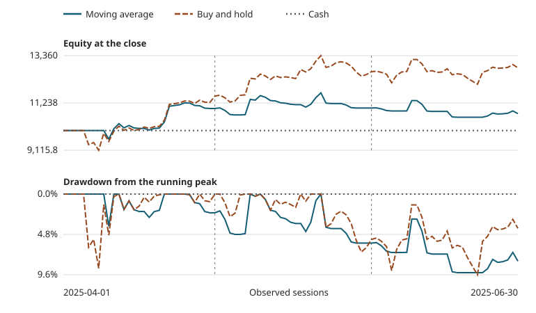

# Agenthon Quant Lab — historical

**Status: passed** · v0.3.0rc1 · 2026-11-15T02:34:24.618171+00:00

This is an offline calculation/simulation. Numerical checks do not establish predictive accuracy or trading profitability.

## Results

91 sessions from 2025-04-01 through 2025-06-30. The input declares unadjusted prices. There are 0 intervening calendar dates without observations.

The portfolio starts with 10,000.00 in cash. The moving-average rule compares the last close to its trailing 5-session mean. Orders execute at the next observed open, with 10 bps in fees and 5 bps in slippage on each fill. Buy and hold observes the same warmup.

### After-cost comparison

Returns use close-marked equity. Excess is the difference from buy and hold in percentage points. Costs combine fees and adverse execution slippage in the starting cash currency.

| Period | Portfolio | Return | Excess (pp) | Max drawdown | Mean exposure | Fees | Slippage | Ending equity | Fills |
|---|---|---:|---:|---:|---:|---:|---:|---:|---:|
| test | Moving average | -2.28% | -4.70 | 6.58% | 53.33% | 75.66 | 37.83 | 10,758.43 | 7 |
| test | Buy and hold | 2.42% | +0.00 | 8.42% | 100.00% | 0.00 | 0.00 | 12,814.43 | 0 |
| test | Cash | 0.00% | -2.42 | 0.00% | 0.00% | 0.00 | 0.00 | 10,000.00 | 0 |
| full | Moving average | 7.58% | -20.56 | 9.36% | 56.04% | 272.32 | 136.16 | 10,758.43 | 25 |
| full | Buy and hold | 28.14% | +0.00 | 9.60% | 94.51% | 9.99 | 4.99 | 12,814.43 | 1 |
| full | Cash | 0.00% | -28.14 | 0.00% | 0.00% | 0.00 | 0.00 | 10,000.00 | 0 |
| train | Moving average | 9.89% | -2.71 | 3.84% | 56.67% | 63.40 | 31.70 | 10,989.38 | 6 |
| train | Buy and hold | 12.60% | +0.00 | 8.84% | 83.33% | 9.99 | 4.99 | 11,260.37 | 1 |
| train | Cash | 0.00% | -12.60 | 0.00% | 0.00% | 0.00 | 0.00 | 10,000.00 | 0 |
| validation | Moving average | 0.18% | -10.93 | 5.83% | 58.06% | 133.26 | 66.63 | 11,009.19 | 12 |
| validation | Buy and hold | 11.11% | +0.00 | 6.90% | 100.00% | 0.00 | 0.00 | 12,511.58 | 0 |
| validation | Cash | 0.00% | -11.11 | 0.00% | 0.00% | 0.00 | 0.00 | 10,000.00 | 0 |

Train 2025-04-01 to 2025-04-30 · Validation 2025-05-01 to 2025-05-31 · Test 2025-06-01 to 2025-06-30

Positions carry through period boundaries. Period drawdowns use the period opening equity as their first peak. The daily drawdown path measures the fall from the highest equity since inception.

All gross and net results, including turnover, are available in the saved results.



[Download daily gross and net curves (CSV)](equity-drawdown.csv)

## Specification

```json
{
  "workflow": "historical",
  "data": "data/bitstamp/btcusd-2025-q2.csv",
  "source": "Bitstamp BTC/USD minute data, github.com/ff137/bitstamp-btcusd-minute-data. USD per BTC. Q2 2025 UTC sessions, first open and last close of positive-volume minute bars. Adapted under CC BY 4.0 https://creativecommons.org/licenses/by/4.0/ from revision d7156d68d85714e188a1e152818281e97c89fbe5.",
  "price_adjustment": "unadjusted",
  "timestamp_convention": "session_date",
  "columns": {
    "date": "SessionUTC",
    "open": "FirstTradeOpen",
    "close": "LastTradeClose"
  },
  "synthetic": false,
  "initial_cash": 10000,
  "fee_bps": 10,
  "slippage_bps": 5,
  "lookback": 5,
  "strategies": [
    "sma",
    "buy_and_hold",
    "cash"
  ],
  "train_end": "2025-04-30",
  "validation_end": "2025-05-31"
}
```

## Assumptions

```json
{
  "workflow": "historical",
  "data": "inputs/data.csv",
  "source": "Bitstamp BTC/USD minute data, github.com/ff137/bitstamp-btcusd-minute-data. USD per BTC. Q2 2025 UTC sessions, first open and last close of positive-volume minute bars. Adapted under CC BY 4.0 https://creativecommons.org/licenses/by/4.0/ from revision d7156d68d85714e188a1e152818281e97c89fbe5.",
  "price_adjustment": "unadjusted",
  "timestamp_convention": "session_date",
  "columns": {
    "date": "SessionUTC",
    "open": "FirstTradeOpen",
    "close": "LastTradeClose"
  },
  "synthetic": false,
  "initial_cash": 10000.0,
  "fee_bps": 10.0,
  "slippage_bps": 5.0,
  "lookback": 5,
  "strategies": [
    "sma",
    "buy_and_hold",
    "cash"
  ],
  "train_end": "2025-04-30",
  "validation_end": "2025-05-31",
  "requested_strategies": [
    "sma",
    "buy_and_hold",
    "cash"
  ],
  "signal": "Long when the completed close exceeds its trailing simple mean. Flat during warmup and on equality.",
  "execution": "Apply the prior close target at the next observed open. Mark remaining shares at the final close.",
  "benchmarks": "Buy and hold is included for every selection and enters after the same warmup. Cash remains uninvested and earns zero.",
  "sizing": "Invest all available cash in fractional shares, including the buy fee. Close the position on a flat target.",
  "costs": "Fees apply to filled notional, and adverse slippage applies to the quoted open on both sides.",
  "periods": "Carry shares and cash through train, validation and test. Each period starts from previous close equity.",
  "drawdown": "Daily path uses the running full-period peak. Each period summary resets its peak to opening equity.",
  "selection": "All parameters and portfolios are fixed by the supplied specification before calculation.",
  "metric_units": "Returns, drawdowns and exposure are fractions. Turnover sums quoted traded notional divided by pre-trade equity."
}
```

## Verification

| Check | Status | Evidence |
|---|---|---|
| sma.gross.ledger_shape_and_quotes | passed | All observations reconciled |
| sma.gross.signal_and_execution_timing | passed | All observations reconciled |
| sma.gross.cash_shares_equity_reconciliation | passed | All observations reconciled |
| sma.gross.fee_slippage_reconciliation | passed | All observations reconciled |
| sma.gross.pnl_reconciliation | passed | All observations reconciled |
| sma.gross.long_only_cash_constraints | passed | All observations reconciled |
| sma.gross.period_accounting | passed | Period opening equities, P&L, returns, counts and costs reconcile to the continuous book. |
| sma.net.ledger_shape_and_quotes | passed | All observations reconciled |
| sma.net.signal_and_execution_timing | passed | All observations reconciled |
| sma.net.cash_shares_equity_reconciliation | passed | All observations reconciled |
| sma.net.fee_slippage_reconciliation | passed | All observations reconciled |
| sma.net.pnl_reconciliation | passed | All observations reconciled |
| sma.net.long_only_cash_constraints | passed | All observations reconciled |
| sma.net.period_accounting | passed | Period opening equities, P&L, returns, counts and costs reconcile to the continuous book. |
| buy_and_hold.gross.ledger_shape_and_quotes | passed | All observations reconciled |
| buy_and_hold.gross.signal_and_execution_timing | passed | All observations reconciled |
| buy_and_hold.gross.cash_shares_equity_reconciliation | passed | All observations reconciled |
| buy_and_hold.gross.fee_slippage_reconciliation | passed | All observations reconciled |
| buy_and_hold.gross.pnl_reconciliation | passed | All observations reconciled |
| buy_and_hold.gross.long_only_cash_constraints | passed | All observations reconciled |
| buy_and_hold.gross.period_accounting | passed | Period opening equities, P&L, returns, counts and costs reconcile to the continuous book. |
| buy_and_hold.gross.benchmark_reference_path | passed | Compared 91 marked equities to the independent buy_and_hold path |
| buy_and_hold.net.ledger_shape_and_quotes | passed | All observations reconciled |
| buy_and_hold.net.signal_and_execution_timing | passed | All observations reconciled |
| buy_and_hold.net.cash_shares_equity_reconciliation | passed | All observations reconciled |
| buy_and_hold.net.fee_slippage_reconciliation | passed | All observations reconciled |
| buy_and_hold.net.pnl_reconciliation | passed | All observations reconciled |
| buy_and_hold.net.long_only_cash_constraints | passed | All observations reconciled |
| buy_and_hold.net.period_accounting | passed | Period opening equities, P&L, returns, counts and costs reconcile to the continuous book. |
| buy_and_hold.net.benchmark_reference_path | passed | Compared 91 marked equities to the independent buy_and_hold path |
| cash.gross.ledger_shape_and_quotes | passed | All observations reconciled |
| cash.gross.signal_and_execution_timing | passed | All observations reconciled |
| cash.gross.cash_shares_equity_reconciliation | passed | All observations reconciled |
| cash.gross.fee_slippage_reconciliation | passed | All observations reconciled |
| cash.gross.pnl_reconciliation | passed | All observations reconciled |
| cash.gross.long_only_cash_constraints | passed | All observations reconciled |
| cash.gross.period_accounting | passed | Period opening equities, P&L, returns, counts and costs reconcile to the continuous book. |
| cash.gross.benchmark_reference_path | passed | Compared 91 marked equities to the independent cash path |
| cash.net.ledger_shape_and_quotes | passed | All observations reconciled |
| cash.net.signal_and_execution_timing | passed | All observations reconciled |
| cash.net.cash_shares_equity_reconciliation | passed | All observations reconciled |
| cash.net.fee_slippage_reconciliation | passed | All observations reconciled |
| cash.net.pnl_reconciliation | passed | All observations reconciled |
| cash.net.long_only_cash_constraints | passed | All observations reconciled |
| cash.net.period_accounting | passed | Period opening equities, P&L, returns, counts and costs reconcile to the continuous book. |
| cash.net.benchmark_reference_path | passed | Compared 91 marked equities to the independent cash path |
| market_source_and_corporate_actions | unavailable | Source, corporate-action treatment and exchange-calendar completeness are user declarations. |

## Warnings and limitations

- Using test-period outcomes to change the strategy compromises the holdout.
- Execution assumes fractional, liquid positions and the declared costs. Dividends, interest, taxes and market impact are excluded.
- Source and price adjustments are user declarations. Both price fields must use the same adjustment basis.
- Calendar gaps count dates between observations. Exchange sessions and data completeness were not independently verified.

## Provenance and reproduction

Source commit: `96400b6120fed81343293053f7b947558cee4af2`; runtime source dirty: `False`.

Source fingerprint (SHA-256, distinct from Git): `788fe94110bc0ccb39c1e5a8e0aa756966230a4111b00dc02714e6bfccdf52df`.

Elapsed seconds: 0.060860. Model calls: 0. Model cost: $0. Randomness: none in the analysis engine.

Input snapshots, content hashes, package versions, full results and check details are in [run.json](run.json).

From the repository root, using the documented environment:

```sh
python -m agenthon_quant reproduce reports/historical-q2 --out runs/reproduced-NEW
```
